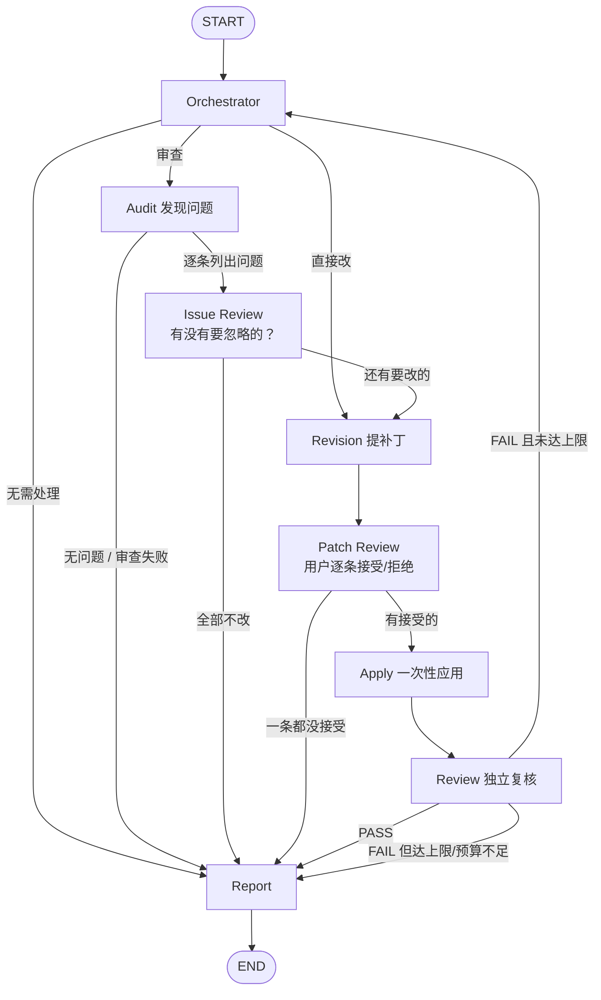

# 学术论文智能修改 Multi-Agent 系统

面向长文本学术论文的自适应 Multi-Agent 修改系统：由 Orchestrator 做任务规划与异常重规划，
通过 **可寻址的段落 ID + 逐条可接受的补丁** 构建"问题发现 → 提出补丁 → 用户勾选 → 应用 → 独立复核"
闭环，并在此之上实现 Agent Harness（Checkpoint/Resume、超时、重试、熔断、Trace、Context 治理、
成本与延迟预算）与评测闭环（Golden Set + LLM-as-Judge + 回归退化检测）。

技术栈：**LangGraph StateGraph + DeepSeek API + LangChain**（另有可选 FastAPI 服务层）。

---

## 一、核心设计

### 1. 每个段落都有稳定 ID，改动必须引用 ID

论文先被解析成**可寻址的块**（章节标题 / 段落 / 表格 / 列表）：

```text
[H01] 面向小样本场景的图神经网络节点分类方法研究
[H02] 摘要
[P01] (1) 近年来，图神经网络…… (2) 但是实际场景中……      <- 可下钻到句：P01:S2
[T01] | 方法 | Cora | Citeseer | Pubmed |
```

- **稳定 ID**：`p3f9a2c1` = 类型前缀 + 内容哈希。改**别的**段落时它不变，
  所以历史补丁依然能对上；本段落被改后 ID 会变，我们在补丁里回填 `span_id_after`，
  把新旧 ID 连成可回溯的链。
- **可读标签**：`P03` / `H02` / `T01`，只在单次 Prompt 里使用，模型写标签，
  系统负责解析回稳定 ID。
- **句级定位**：补丁可引用 `P03` + 第 2 句 + 逐字引用原文，三重校验后才允许落地。

为什么必须这样：没有 ID 就只能靠"把原文片段拿去字符串匹配"，
歧义时要么改错地方、要么整条丢掉，也无法"拒绝某一条"或"回溯改了什么"。

### 2. 一次给出全部改动，用户只做一次勾选

```text
[patch-001] P01（第 4 句）｜语言表达（高）
  修改前：我们在三个公开数据集上进行了实验，实验结果表明本文提出的方法比基线方法要好。
  修改后：我们在 Cora、Citeseer 和 Pubmed 三个公开数据集上进行了实验……
  理由：补充摘要中缺失的数据集名称、评价指标与关键数值，使结论有据可依
          （数值取自正文表 T01，未改动任何实验数据）。   <- 理由由 Agent 写，用户不用写
```

用户只需要说"要哪些"：回车=全接受，`none`=全拒绝，或输入编号。
被拒绝的改动**不会写进论文**，也不会在下一轮被重复提出（除非用户自己再提）。

### 3. Workflow：正常路径稳定，异常才重新规划



- Orchestrator 只在两个时间点介入：任务开始、Review FAIL 之后（避免每一步都调高成本 Planner）。
- 两道人工闸门，各自解决一件事，**都默认"直接回车继续"**：
  | 闸门 | 解决什么 | 默认 | 决定存在哪 |
  | --- | --- | --- | --- |
  | Issue Review（Audit 之后） | 这些问题**有没有要忽略的** | 都要改 | `user_rules`（kind=ignore，带指纹） |
  | Patch Review（Revision 之后） | 这些改动**接不接受** | 全接受 | 补丁状态 + `rejected_memory` |
- `PRA_ISSUE_GATE=0` 可以关掉第一道闸门（只留补丁清单）。
- Review 判定"是否达标"，Orchestrator 只决定"接下来怎么办"；**用户拒绝的范围不计入未完成**。

### 4. 用户说的"点"存在哪里

统一存在 State 的 **`user_rules`**（带编号、可撤改、跨轮次有效），并落盘到
`data/runs/<run_id>/state.json`、`session.json`，随 Checkpoint 一起持久化：

```json
[
  {"id": "R1", "kind": "rule",   "text": "全文统一把「土豆」写成「马铃薯」",
   "status": "active",  "created_turn": 1},
  {"id": "R2", "kind": "ignore", "text": "不改 P13：消融实验…",
   "signature": {"span_label": "P13", "problem": "消融实验…"},
   "status": "active",  "created_turn": 1}
]
```

- **要求（rule）**：开局 `--rule`、问题闸门、多轮追问里都能加；
- **不改（ignore）**：问题闸门里勾一下就有了；存的是**指纹**（位置＋分类＋问题摘要），
  所以下一轮重新审查时问题编号变了也认得出，不会再问一遍；
- 用户可以随时改主意：`取消 R1`、`R1 改成 ……`、`记住：……`（多轮追问里直接说）；
- 这份清单会进 **四个 Agent 的上下文**，尤其是 Audit（不去报用户已经说不用管的问题）
  和 Review（不把用户明确不改的东西算作"未完成"）。

这就是本项目需要的全部"记忆"：一次任务内的对话上下文 + Checkpoint，不需要额外的长期记忆系统。

### 5. 每次 Agent 调用都有输出

控制台每调用一次就有可读的一行（含耗时、Token 与返回内容预览）：

```text
[orchestrator] initial_plan 完成：5618ms · 1664 tokens
    → {"plan_kind": "full_review", "next_action": "audit", ...}
[audit] chunk_1 完成：3431ms · 2590 tokens
[revision] batch_1 完成：6263ms · 4076 tokens
[review] verify 完成：2643ms · 5956 tokens
```

同时把**完整 Prompt 与返回**写进 `data/runs/<run_id>/llm_calls.jsonl`
（默认开启，`PRA_LOG_LLM=0` 关闭，`PRA_LOG_PROMPT_CHARS` 可限制长度），
排查"这个 Agent 到底看到了什么"时直接翻这个文件。

### 6. 多轮会话

```python
result = harness.start("请全面检查并修改这篇论文。", document)   # 第 1 轮
result = harness.resume({"accepted_ids": ["patch-001", "patch-003"]})
result = harness.follow_up("取消 R1；把引言里关于小样本困难的段落写得更具体")  # 第 2 轮
```

- 复用同一个 `thread_id`，已接受的改动、被拒绝的改动、审查结果都在 State 里，模型不会"忘了上下文"；
- 被拒绝的改动、被忽略的问题都会出现在下一轮的 Prompt 里，避免重复打扰；
- 这一轮的话里可以夹"改要求"的指令（`记住：…` / `取消 R1` / `R1 改成 …`）；
- 只重置本轮的临时字段（迭代计数、计划、上一轮复核结论）。

### 7. State 与 Context 分离

```text
完整任务状态（State）
        ↓  Context Manager（按 Agent 字段白名单 + 预算裁剪）
当前 Agent 真正需要看到的信息
        ↓
      LLM
```

- 分块**按段落边界**切（不是按字符），所以每个分块里的 ID 都是完整可引用的；
- Revision 只对"被点名"的段落标出句子编号，其它块只给标签，省 Token；
- 超预算时按优先级"头尾保留 + 中间省略"。

### 8. 成本与延迟预算

| 指标 | 配置项 | 默认 |
| --- | --- | --- |
| 每任务 token 上限 | `PRA_BUDGET_RUN_TOKENS` | 400000 |
| 每轮 token 上限 | `PRA_BUDGET_TURN_TOKENS` | 150000 |
| 墙钟上限 | `PRA_BUDGET_RUN_SECONDS` | 1800 |
| 单 Agent 调用次数上限 | `PRA_BUDGET_CALLS_PER_AGENT` | 40 |
| 单次调用超时 | `PRA_AGENT_TIMEOUT` | 180 |
| 并发任务数（服务层） | `PRA_MAX_CONCURRENT_RUNS` | 2 |

超预算不是崩溃，而是**降级**：Audit 不再开新分块、Revision 不再开新批次、
Review 直接收敛出报告（并标注"结论仅基于确定性检查"）。用量从 trace 实时汇总，
报告里会给出实际消耗、各 Agent 调用次数与降级原因。

---

## 二、目录结构

```text
paper_revision_agent/
├── main.py                     # 命令行入口（补丁勾选 + 多轮追问）
├── test_llm.py                 # DeepSeek 连通性自检
├── app/
│   ├── config.py               # 全局配置（模型/超时/重试/熔断/预算/闸门/路径）
│   ├── document/               # ★ 文档模型层
│   │   ├── spans.py            #   段落/句子稳定 ID、按块分块、带 ID 渲染
│   │   ├── patches.py          #   补丁对象、定位校验、逐条决定、一次性应用
│   │   ├── docx_model.py       # ★ 读 Word：文字 ↔ XML 锚点一一对应（含公式/图片/表格/代码）
│   │   └── docx_redline.py     # ★ 写回 Word：原生修订痕迹（w:ins/w:del）+ 批注
│   ├── state/schema.py         # PaperState 定义
│   ├── agents/                 # 4 个 Agent + Report
│   │   ├── prompts.py          #   所有 Prompt 模板
│   │   ├── orchestrator.py     #   规划 + 重规划（含规则兜底）
│   │   ├── audit.py            #   分块审查（按段落边界）+ 问题定位
│   │   ├── revision.py         #   一次提出本轮全部补丁
│   │   ├── review.py           #   独立复核 + 确定性检查
│   │   └── report.py           #   汇总报告与落盘
│   ├── workflow/
│   │   ├── graph.py            # StateGraph 装配 + SQLite Checkpointer
│   │   ├── nodes.py            # 节点（含补丁审阅 interrupt、apply）
│   │   ├── router.py           # 条件边与各类熔断
│   │   └── harness.py          # start / resume / follow_up / auto-approve
│   ├── utils/                  # LLM 封装、JSON 解析、文本、Context、重试熔断、Trace、预算、
│   │                           #   用户要求与决定（rules.py）、文件加载（loaders.py）
│   ├── service/runs.py         # ★ 与框架无关的任务服务层（后台线程 + 状态落盘）
│   └── ui/streamlit_app.py     # 可选界面
├── evals/                      # 评测闭环（Golden Set / LLM-as-Judge / 回归）
├── data/
│   ├── samples/sample_paper.md
│   ├── golden/golden_set.jsonl
│   ├── runs/                   # 运行产物（报告 / 补丁 / Trace / 状态快照）
│   └── checkpoints/            # SQLite Checkpoint（重启后继续）
└── tests/                      # 208 个离线测试（unittest，可无网络运行）
```

---

## 三、快速开始

```bash
pip install -r requirements.txt
cp .env.example .env          # 填入 DEEPSEEK_API_KEY

python test_llm.py                                   # 连通性自检
python main.py --show-graph                          # 查看 Workflow 结构

# 先看"论文被读成了什么"（不调用模型、不花钱）
python main.py --file "D:\我的论文.docx" --inspect

# 直接给文件：支持 .docx / .pdf / .md / .txt（路径带空格要用引号）
# 给 .docx 时，改完会在 data/runs/<run_id>/ 另存一份带修订痕迹的 Word 副本
python main.py --file "D:\我的论文.docx" --request "全面检查并修改这篇论文"
python main.py --file data/samples/sample_paper.md --request "全面检查并修改这篇论文" \
    --rule "全文统一把「土豆」写成「马铃薯」"
python main.py --file data/samples/sample_paper.docx --auto-approve   # 无人值守

# 全面检查并修改：中途会先问“有没有要忽略的问题”，再列出补丁清单
# （Audit 后会先问“有没有要忽略的问题”，然后才是补丁清单；都回车即默认）
python main.py --file data/samples/sample_paper.md --request "全面检查并修改这篇论文" \
    --rule "全文统一把「土豆」写成「马铃薯」"

# 无人值守（全部接受）
python main.py --file data/samples/sample_paper.md --auto-approve --constraint "不要修改实验结果"

# 只改局部，跳过全文审查
python main.py --text "摘要太啰嗦" --request "只修改摘要，不要审查全文"
```

程序化调用：

```python
# 文件 -> 文本（.docx / .pdf / .md / .txt，自动识别编码）
from app.utils.loaders import load_document, load_bytes

loaded = load_document("D:/我的论文.docx")
print(loaded.describe())      # docx，2060 字符，34 段
document = loaded.text

# 界面/接口上传是字节流：
# loaded = load_bytes(uploaded.getvalue(), filename=uploaded.name)
```

```python
from app.workflow.harness import Harness

harness = Harness()
result = harness.start("全面检查并修改", document)
harness.start("全面检查并修改", document, rules=["全文统一把「土豆」写成「马铃薯」"])
while result.is_interrupted:
    request = result.pending_request
    if request["type"] == "issue_review":
        payload = {"ignore_ids": [2]}                    # 第 2 条不改（会被记住）
    else:
        patches = request["patches"]                     # 一次看全部改动（含理由）
        payload = {"accepted_ids": [p["patch_id"] for p in patches[:3]]}   # 只接受前 3 条
    result = harness.resume(payload)

# 多轮：可以顺手改要求（记住：… / 取消 R1 / R1 改成 …）
result = harness.follow_up("取消 R1；把引言里关于小样本困难的段落写得更具体")
print([(rule["id"], rule["kind"], rule["text"]) for rule in result.state["user_rules"]])
print(result.final_report, result.revised_document)
```

---

## 四、上传论文（文件支持情况）

| 格式 | 支持情况 | 说明 |
| --- | --- | --- |
| `.docx` | ✅ 推荐 | 保留标题层级（Heading 1/2/3 → `#/##/###`）、列表与表格（→ Markdown 表格），因此标题/段落/表格都会成为**带 ID 的可寻址块**；改完还能**写回 Word 原文件**（见 4.5） |
| `.pdf` | ✅ 可用 | 优先 pypdf，其次 pdfplumber；**扫描版没有文字层**时会提示需要 OCR；公式/分栏版式可能丢失，关键段落建议核对 |
| `.md` / `.txt` | ✅ | 自动识别 UTF-8 / UTF-8-BOM / GBK / GB18030 / Big5（记事本存的 ANSI 中文不会乱码） |
| `.doc` / `.wps` / `.caj` | ❌ | 会给出可执行的提示（另存为 .docx 或导出 PDF） |

依赖：`python-docx`、`pypdf`、`pdfplumber`（在 `requirements-extras.txt` 里）。
没装也能跑：docx 会退回内置的 zipfile + XML 解析器；PDF 会明确告诉你装 `pypdf`
或改用 .docx。

仓库里放了一份现成的 Word 样例 `data/samples/sample_paper.docx`，可以直接拿来试上传。

### 4.1 结构自检（强烈建议先跑一次）

```bash
python main.py --file "D:\我的论文.docx" --inspect
```

输出示例：

```
字符数：35085    块数：749
分区：正文 627，目录 64，参考文献 19，封面 18，摘要 10，致谢 7
标题 154 个，表格 0 个，按噪声跳过 51 个
默认送审（摘要+正文）：588 块（可用 PRA_AUDIT_SCOPE=body+refs / all 调整）
```

### 4.2 结构是怎么还回来的

论文不是"一堆文字"，而是有分区的：

| 处理 | 说明 |
| --- | --- |
| 标题识别 | 除了 Markdown 标题，还认 `摘    要`（人为拉开字距）、`目 录`、`致 谢`、`1.1 xxx`、`第一章` 等 |
| 文档分区 | 自动区分 封面 / 前置材料 / 目录 / 摘要 / 正文 / 参考文献 / 致谢 / 附录；**封面、目录、承诺页、致谢默认不审**（`PRA_AUDIT_SCOPE=body`，可改 `body+refs` / `all`） |
| 目录去噪 | 目录条目（"1.1 研究背景 …… 1"）即使长得像章节标题，也不会混进正文 |
| 噪声跳过 | 页码、签名行、目录行会被标出并跳过（报告里给出数量） |
| **公式保留** | Word 公式是 OMML 对象：现在会提取成 `【公式：…】`。以前完全没取，模型看到"公式如下："后面是空的，就会误报"公式缺失" |
| 编码兼容 | UTF-8 / GBK / GB18030 / Big5 自动识别 |

> PDF 的公式与版式本质上拿不到（没有文字层），**能传 .docx 就传 .docx**。

### 4.3 审查精度（为什么不会给一篇好论文报一堆问题）

| 机制 | 效果 |
| --- | --- |
| 证据逐字核对 | evidence 在对应段落里找不到 → 直接丢弃（防幻觉、防错位） |
| 同类系统性问题合并 | "参考文献格式不统一"在十几处出现 → **只报一条**，并列出涉及段落（"共 12 处，另见 P581、P583…"） |
| 严重程度门槛 | 默认丢掉 low（`PRA_AUDIT_MIN_SEVERITY=low` 可放开） |
| 取消"每块 5 条"配额 | 改为"没有就返回空数组"，每块最多 3 条 |
| 总量上限 | `PRA_AUDIT_MAX_ISSUES`（默认 15） |
| 跨批次对齐 | 后面的批次能看到前面批次已提出的改动；Review 拿到**完整**改动清单（不再截断成 20 条） |
| 术语一致性（确定性） | 用"用户要求 + 已应用补丁"反推术语替换表，全文扫描：已统一成"马铃薯"但别处还写"土豆" → 直接要求下一轮补齐 |
| 删除类修改 | 支持 `delete: true`（删除内容），空替换会被要求显式标注 |
| **专有名词写法** | Prompt 明确要求核对方法名/模型名/数据集名/人名/缩写的写法与大小写；并叠加一层**确定性扫描**：同一个词全文出现 "PubMed / Pubmed"、"GraphSAGE / Graph-SAGE" 这类多种写法时，直接把证据（各写法 + 出现段落）放进审查上下文，模型据此只报一条，不必凭印象猜 |

### 4.4 审计到底审什么（以及审不到的）

这一节回答"它会不会看图表、公式、表格"。

| 内容 | 会审吗 | 说明 |
| --- | --- | --- |
| 正文段落、标题 | ✅ | 带段落 ID（`[P03]`）逐块送审 |
| **表格内容** | ✅ | 表格转成 Markdown 表格后整块送审：格子里的文字、数字、方法名都会被看到，能发现"表格数值与正文结论不一致""表头术语与正文不一致" |
| **公式** | ⚠️ 只看到文字 | Word 公式（OMML）会被拍平成 `【公式：…】`。真分数 `(a+b)/(c-d)` 拍平后是 `a+bc-d`——**分数/上下标/矩阵的结构会丢**。所以能发现"公式没解释、符号没定义、正文说'如式(3-1)'却没编号"，**不能**判断推导对不对 |
| **图 / 图表（图片）** | ⚠️ 只看到文字 | 图片是二进制对象，模型看不到像素。它会审图题、图注、正文里对图的描述与数值（如"如图 3.1 所示"是否有对应图），**不能**判断图里曲线、坐标轴、清晰度、配色 |
| 代码段 | ✅ | 软回车还原成换行，代码不会被糊成一行 |
| 参考文献 | ❌ 默认不审 | `PRA_AUDIT_SCOPE=body+refs` 才审 |
| 封面 / 诚信承诺 / 目录 / 致谢 / 附录 | ❌ 默认不审 | `PRA_AUDIT_SCOPE=all` 才审（默认不审是不让排版内容被当成论文问题） |
| 页眉页脚、页码、批注 | ❌ | 不在正文里，读不到 |

审不到的部分主要来自几个可调的预算：

| 限制 | 默认值 | 影响 | 怎么调 |
| --- | --- | --- | --- |
| 单批大小 | `PRA_AUDIT_CHUNK_TOKENS=1500` | 每批约 1500 token（中文 1 字 ≈ 1 token） | 调大以减少批数 |
| 批数上限 | `PRA_AUDIT_MAX_CHUNKS=24` | **最多只审前 24 批 ≈ 3.6 万字**；超长论文后半段不会被审（报告与日志会明确写出来） | 调大以覆盖全文 |
| 问题上限 | `PRA_AUDIT_MAX_ISSUES=15` | 合并后的总问题数 | 按需要调 |
| 严重程度门槛 | `PRA_AUDIT_MIN_SEVERITY=medium` | `low`（可改可不改）直接丢弃 | 改 `low` 放开 |
| Review 视野 | `PRA_CTX_REVIEW=8000` | 复核看的是"全文头部 + 全文尾部 + 中间省略"的视图 | 调大 |

> 确定性检查（术语 / 专有名词一致性、重复段落、补丁定位、被拒绝的改动是否泄漏）是**全文**跑的，不受上面这些上限影响。
> 模型给出的每条问题还必须附**逐字原文引用**（在该段落内唯一），核对不上的会被直接丢掉（报告里的 `dropped_unverifiable` 就是被丢掉的条数）。

### 4.5 改动写回 Word（修订痕迹 + 批注）

前面几节解决的是"改得对不对"，这一节解决**"改在哪儿"**：
上传 `.docx` 时，被接受的改动会写回 Word 原文件，另存一份副本
`data/runs/<run_id>/revised_document.docx`，**原文件一个字都不动**。

打开副本你会看到：

- 每一处改动都是 Word **原生修订痕迹**（`<w:ins>` / `<w:del>`），
  可以逐条接受或拒绝，也可以一键全部接受；
- 每处改动带一条 **Word 批注**，写的是 Agent 给的理由（就是补丁清单里那条理由）；
- 字体、字号、编号、页眉页脚、图、表、公式**原样保留**——
  只动被改的那几个字，其余内容连 XML 都没碰。

为什么能做到：读取时除了文字，还记下了"每个字在 `document.xml` 里对应哪个节点、
从第几个字到第几个字"（`app/document/docx_model.py`）；回写时按这份对应关系
定位到 run 级别，只切被改动的那一小段（`app/document/docx_redline.py`）。

**不确定就不改**。下面这些情况回写层会**拒绝**，并在文档原位留一条批注
提示你手工处理（同时列在报告的"需要在 Word 里人工处理的改动"一节）：

| 情况 | 为什么拒绝 |
| --- | --- |
| 改动跨了多个表格单元格 | Markdown 表格里的竖线在 Word 里根本不存在，无法一一对应 |
| 半句改动却把公式圈进了范围 | 公式是 OMML 对象，不是文字；硬改会破坏公式 |
| 改动范围里有图片等图形对象，且不是整段重写 | 宁可不动，也不要把图删掉 |
| 原文与补丁记的"修改前"对不上 | 说明文档在中间被别的程序改过，定位不可靠 |

能自动处理的三种情况是：**整段重写**（连公式一起替换，前提是这段没有图片）、
**句内替换**（按 run 切开，只切被改的那几个字）、**表格单元格内替换**。

多轮会话也支持：回写不是"把最后一次的文字翻译成 Word"，而是
**原文件 + 第 1 轮改动 + 第 2 轮改动……** 逐轮重放，
所以第二轮改的可能是第一轮刚插进去的文字，链条照样完整。

开关（`.env`）：

```bash
PRA_DOCX_OUTPUT=1                 # 0 = 只输出 Markdown，不生成 Word 副本
PRA_REDLINE_AUTHOR=论文修改助手    # Word 里显示的"谁改的/谁写的批注"
PRA_REDLINE_COMMENTS=1            # 0 = 只留修订痕迹，不写批注
```

依赖：`lxml`（`pip install lxml`，或 `pip install python-docx` 会一起装上）。
没装不影响修改流程，只是退回"只输出 Markdown"，并在读取时就提示你。

---

## 五、产物

每次运行写入 `data/runs/<run_id>/`：

| 文件 | 内容 |
| --- | --- |
| `report.md` | 完整报告：问题清单、逐条补丁（含理由与决定）、复核结论、预算用量 |
| `revised_document.md` | 修改后的论文（只包含被接受的改动） |
| `revised_document.docx` | **把改动写回 Word 的副本**：原生修订痕迹 + 批注，原文件不动（上传 .docx 时才有） |
| `original_document.md` | 原始论文 |
| `edits.json` | 各轮补丁明细与新旧段落 ID |
| `state.json` | 状态快照（重启后重建"待确认补丁"面板） |
| `trace.jsonl` | 每个 Agent 的耗时/重试/Token，逐行追加 |
| `llm_calls.jsonl` | 每次模型调用的完整 Prompt 与返回（`PRA_LOG_LLM=0` 可关） |

---

## 六、Harness：让长任务跑得稳

| 能力 | 实现位置 | 说明 |
| --- | --- | --- |
| Checkpoint / Resume | `workflow/graph.py`、`harness.py` | 默认写 SQLite，**服务重启后暂停中的任务仍能继续**；进程内并发共用一个连接避免抢锁 |
| 异常隔离 | `workflow/nodes.py` | 单 Agent 失败只降级该节点 |
| Timeout / Retry / 熔断 | `utils/resilience.py` | 每个 Agent 独立统计，连续失败到阈值后快速失败 |
| 迭代上限 | `workflow/router.py` | Review FAIL 循环到上限即输出当前最优结果 |
| Trace | `utils/tracing.py` | 从 trace 文件汇总，重启不丢 |
| 预算 | `utils/budget.py` | token / 时间 / 调用次数，超限降级而不是崩 |
| Context 治理 | `utils/context.py` | 按 Agent 白名单裁剪，长文分块按段落边界 |

---

## 七、评测闭环

```bash
python -m evals.runner --limit 5 --tag prompt-v2
python -m evals.regression 基线.json 新版本.json --threshold 0.2   # 退化则退出码 1
```

四个维度：**语法 / 原意 / 学术规范 / 降重**。结果会带系统指纹，指纹不一致会提示"仅供参考"。

---

## 八、测试

```bash
python -m unittest discover -s tests -t .      # 208 个测试，全部离线（假 LLM）
pytest -q                                      # 也可以
```

覆盖：段落/句子 ID 稳定性、补丁定位与歧义处理、逐条接受/拒绝、一次性应用与重叠检测、
问题忽略的跨轮记忆、要求的新增/修改/撤销、模型调用落盘、
docx/pdf/txt 加载与编码兼容（含内置 docx 解析器）、
结构分区（封面/目录/摘要/正文/参考文献/致谢）、Audit 精度（证据核对/同类合并/严重程度门槛）、
跨批次术语一致性、删除类修改、OMML 公式提取、
新旧 ID 回溯、人工暂停与恢复（含模拟重启）、多轮会话与拒绝记忆、预算降级、
各类熔断与路由、报告与评测回归。

---

## 九、常见问题

**Q：为什么要给段落编 ID？直接改不行吗？**
A：没有 ID 就无法"定位、拒绝、回溯"：模型说改了哪里、用户拒绝了哪一条、
这版论文和上一版对应哪一段，全都说不清。ID 是逐条审阅与多轮会话的前提。

**Q：用户说的"土豆都写成马铃薯"这种点存在哪里？**
A：存在 State 的 `user_rules` 里（带编号 R1/R2、可撤改），随 Checkpoint 与
`state.json` 持久化，并注入四个 Agent 的上下文。它只在本次任务内有效——
这正是一次任务里的多轮对话，不需要额外的长期记忆系统。

**Q：为什么理由不是用户写？**
A：理由由 Revision Agent 写（改动内容 + 依据），用户只做勾选。
需要拒绝时可以一键拒绝，不必打字。

**Q：为什么改动要一次性给出来？**
A：避免"提一条问一次"的来回确认。Revision 一次产出本轮全部补丁，
用户在同一张清单上一次性勾选，然后一次应用。

**Q：为什么不做长期 Memory？**
A：这是单论文、单任务的有限生命周期场景；跨任务的用户偏好属于未来扩展。
当前用 State + Checkpoint 保存任务上下文（含已接受/已拒绝的改动）。
