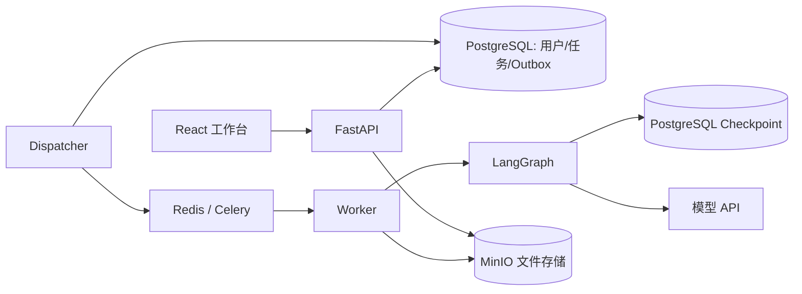

# 架构与阅读顺序

## 从网页到 Word

FastAPI 保存任务后返回任务编号。任务和 Outbox 在同一事务提交，Redis 暂不可用时 Dispatcher 可以稍后补发。Worker 通过数据库锁和执行令牌保护同一任务，运行到人工确认节点便退出当前执行片段。

用户的选择带有 pending ID 和任务版本，服务端校验后持久化并投递恢复任务。浏览器刷新或暂时关闭不应丢失待确认内容。Celery 提供的是可能重复投递的队列，不能假设任务只执行一次。

## 核心模块

| 模块 | 负责什么 | 不应承担什么 |
| --- | --- | --- |
| `app/web/api.py` | 应用组装、中间件、健康检查 | 承载所有业务接口 |
| `app/web/routes/` | 按认证、任务、用户分组的 HTTP 接口 | 调用模型或等待整篇论文完成 |
| `app/web/dependencies.py`、`schemas.py` | 共享身份依赖、Cookie、请求结构 | 业务事务或文件写回 |
| `app/web/service.py` | 业务事务、归属校验、额度、决策提交 | 文档 XML 编辑 |
| `app/web/worker.py` | 执行片段、心跳、模型额度、任务结果存储 | 前端展示规则 |
| `app/workflow/nodes.py` | Agent 调用、状态迁移、人工暂停 | 解析界面特有的输入 |
| `app/workflow/payloads.py` | 人工输入规范化、公开字段投影 | 模型调用和中断 |
| `app/workflow/interaction.py` | 各客户端共用的请求类型与响应校验 | 根据缺失字段猜闸门 |
| `app/agents/audit.py` | 并发审查、跨章节对照、全篇核查 | Word 写回 |
| `app/agents/audit_context.py` | 从原文选择专名、章节和数字对照材料 | 调用模型或改写原文 |
| `app/agents/audit_findings.py` | 审查证据验证、合并、筛选 | 外部服务调用 |
| `app/agents/prompts/` | 按角色组织模板、复用共享约束 | 藏入业务执行逻辑 |
| `app/agents/revision/agent.py` | 修订批次编排、模型生成和一次校验重试 | HTTP 或 DOCX 写入 |
| `app/agents/revision/targets.py` | 问题范围、关联原文、用户选择和明确要求 | 模型调用 |
| `app/agents/revision/patches.py` | 术语补丁、代码保护、拒绝记忆和无效候选过滤 | 文件存储 |
| `app/document/history.py` | 读出当前与旧快照中的应用/失败记录 | 依赖具体 Agent |
| `app/document/patches.py` | 补丁状态、定位和内存文本修改 | 直接接受模型的任意原文位置 |
| `app/document/final_review.py` | 多轮修改归并到原稿坐标 | 把独立复核的不确定性全部报成写回失败 |
| `app/document/docx_redline.py` | 在原 DOCX 上写入修订和批注 | 重写整篇文档以规避结构限制 |
| `app/document/structured.py`、`operations/` | 结构操作调度；验证、XML、表格、公式分别实现 | 恢复已关闭的新增引用或表格能力 |
| `frontend/src/features/review/` | 审阅视图、布局联动 hook、人工事项展示 | 修改补丁语义或绕过后端确认 |

`app/service/runs.py` 是本机 CLI / Streamlit 的运行管理器；`app/web/service.py` 是多用户部署的业务服务。二者共享 Harness 和交互协议，但并发与持久化实现不同，不是两份可随意互换的后端。

## 补丁的生命周期

1. 原稿解析为带 ID 的块；模型返回位置、逐字原文、修改内容和原因。
2. 程序检查引用、代码保护、操作能力及冲突，得到可执行候选或人工事项。
3. 修改先应用于内存文本并记录历史；独立复核可触发下一轮。
4. 最终确认基于不可变原稿合并多轮改动；用户可以逐项拒绝。
5. 从原始 DOCX 导出接受的改动，记录实际写入和失败结果。

`span_id` 基于内容定位，不等于原论文页码，也不是永久不变的数据库主键。文本修改后需要追踪新 ID；网页位置来自原稿渲染映射及章节名。

## 必须保持的约束

- `pending_request` 原样持久化，恢复时不根据 proposed patches 等旁证推测当前闸门。
- 用户选择的实验方案必须沿后续流程传递；不能将“补实验”自动改成“删除实验描述”。
- 文档没有相关术语不构成“无法修改”；超出分块范围应重新定位，不能把模型视野限制转嫁给用户。
- 文档内部对象不做暴力替换。无法安全定位或写入时保留具体原因。
- 状态更新以 LangGraph 节点返回值为准；只修改局部字典不会自动成为持久状态。
- 真实文件和预览下载都要校验任务归属；桶不公开。

## 当前仍有的复杂度

审查调度和 DOCX 原生修订仍是较大的模块。它们包含跨段落证据、XML 对象保护和多轮回放，不适合为了缩短文件而拆成相互循环依赖的小文件。结构操作与预览交互已经独立；后续拆分应保持端到端回归，不用增加抽象层来代替减少重复逻辑。

部署用依赖有固定版本与范围混用，Python 安装尚不是完整跨平台锁定；不要把当前 requirements 文件称为可重现锁文件。高并发、任意不可信文档转换隔离、存储保留周期仍需独立运维设计。
